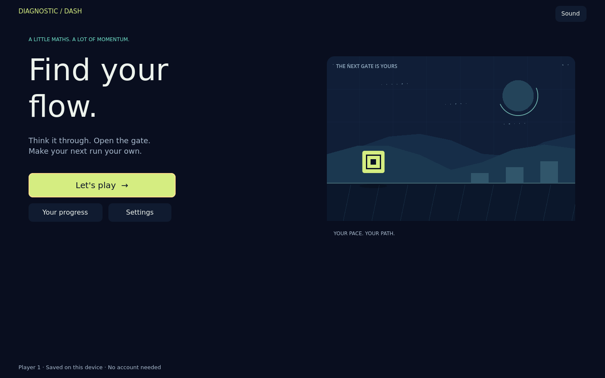

# Diagnostic Dash — Godot edition

**Think it through. Open the gate. Find your flow.**

A complete Godot 4.7.2 arithmetic runner for desktop and the web. This repository contains the editable game, a prebuilt browser export, source-grounded design documents, and an entirely local test workflow using the real open-source [Ramen Autopilot](https://github.com/ramenvr/autopilot) Godot instrumentation.



## Play the browser build

The [ready-to-run browser archive](dist/diagnostic-dash-web.zip) is included in this repository.

Download or clone this repository, then unpack the included export and serve it over HTTP:

```sh
python3 -m zipfile -e dist/diagnostic-dash-web.zip build/web
python3 tools/serve.py
```

Open **http://127.0.0.1:8060/**. Double-clicking `index.html` through a `file://` URL will not load WebAssembly correctly. Any static HTTPS host can serve the extracted files; no backend, account, COOP/COEP headers, model API, or subscription is required. The export uses the Compatibility renderer and a single WebAssembly thread. A recent browser with WebGL 2 is required.

The first successful online load caches the game for later offline visits on the same origin. Keep the tab open until the initial download finishes. Offline caching is best-effort browser storage, not a backup service.

## The game

- **Practice:** untimed gates wait for you. Hints and retries are always available.
- **Classic:** gates have a readable time window; a timeout becomes supported practice on the same fact.
- **Cadence:** the same honest timing and arithmetic with a steady synthesized beat and restrained course pulses.
- Addition, subtraction, multiplication, division, or mixed facts; families 0–5, 0–10, and 0–12; sessions of 6, 12, or 24 solved gates.
- Three pace choices for timed modes: 14, 10, or 7 seconds per gate.
- Correct answers open a safe route and trigger an assisted jump. Optional manual jumping adds a motor challenge without changing learning evidence.
- Three separate local player slots, interrupted-run recovery, saved session history, and JSON result export.
- Keyboard and touch controls, reduced motion, sound settings, clear focus, and original procedural scenery.

The family label refers to underlying arithmetic facts. Addition can produce twice the selected range; subtraction preserves the original `(b + difference) − b` family; division uses integer quotients; multiplication/division tables stop at 12. The remake intentionally consolidates the original Practice/Speed Racer/Blitz and Classic/Cadence axes into three session presets. It also uses explicit answer submission and finite practice sessions. See the design documents for the reasons and differences.

### Controls

| Action | Keyboard | Touch/mouse |
|---|---|---|
| Enter answer | Number keys | Number pad |
| Submit | Enter | Enter/arrow button |
| Delete digit | Backspace | Delete button |
| Jump | Space or ↑ | Jump |
| Hint | H | Hint |
| Pause/resume | Escape or P | Pause / Back to the run |
| Navigate menus | Tab, Shift+Tab, Enter | Buttons |

### What results mean

First-try accuracy is **unassisted correct first responses / observed question occurrences**. A wrong response, subsequent retries, and timeout on the same question do not create extra opportunities. Hints and timeout recovery never become independent success. Ending a session without answering the displayed question invents no outcome.

Response samples contain actual submitted-response intervals in active time. Pause, hidden-tab time, gate-opening animation, and unanswered timeout duration are excluded. Obstacle collisions are game events; they never change mathematical accuracy. Local progression is practice history, not a validated assessment or a diagnosis.

## Open and edit in Godot

Install the standard **Godot 4.7.2** editor (not the .NET variant), import `project.godot`, and press F6/F5. No asset download is needed. All artwork is procedural; audio is synthesized; the bundled DejaVu Sans font includes its license.

For a reproducible Linux x86-64 tool install:

```sh
bash tools/install_godot.sh
export GODOT_BIN="$PWD/.tools/godot/Godot_v4.7.2-stable_linux.x86_64"
export XDG_DATA_HOME="$PWD/.tools/data"
```

The installer downloads official pinned engine/template archives and verifies SHA-256 checksums. The template download is large because Godot distributes platforms together; only the single-threaded web templates are extracted. On macOS/Windows, install the matching editor and export templates through Godot's official distribution instead.

### Export from source

```sh
GODOT_BIN=/path/to/godot bash tools/export_web.sh
python3 tools/serve.py
```

Outputs: `build/web/` and `dist/diagnostic-dash-web.zip`. `build/web/build-manifest.json` records the engine, build identifier, byte sizes and SHA-256 hashes. The prebuilt archive is regenerated from this source, not a JavaScript imitation of the game.

## Run the tests

Native tests need only Godot:

```sh
godot --headless --path . --script tests/test_learning.gd
godot --headless --path . --script tests/test_game.gd
godot --headless --path . --script tests/test_session.gd
```

The learning suite executes 600 frozen original-JavaScript traces and verifies arithmetic, question selection, evidence, conservative assistance handling and persistence. Course tests exercise actual simulation and fair obstacle crossings. Session tests run the real scene and validate clocks, input, recovery and profiles.

For the actual Autopilot Godot bridge with a deterministic local driver:

```sh
python3 -m pip install -r tools/autopilot-requirements.txt
python3 tools/autopilot_local.py --godot /path/to/godot --scenario goals --seed 73 --output evidence/runs/autopilot
```

This is **a local driver using Autopilot's unmodified instrumentation**, not an Aura/Jev model-driven autonomous run. The vendored addon is pinned, its license is preserved, and it is excluded from the production web export. The local driver opens a loopback WebSocket server and sends actual key and UI input. It does not require inference, authentication, a trial, or paid hosting. [The audit](docs/AUTOPILOT-AUDIT.md) explains the upstream service dependencies and exactly what was exercised.

For the exported game in real browser engines:

```sh
npm ci
npx playwright install --with-deps chromium firefox webkit
python3 tools/serve.py --port 8060
# In another terminal:
node tests/browser.mjs --engines chromium,firefox,webkit --run-id local
```

The browser suite configures synthetic fixtures through `?qa=1`, then uses actual keyboard, pointer and touch input. That query exposes a read-only game snapshot, including the answer, solely for explicit QA. Normal URLs do not expose the QA snapshot or command callback. The ordinary public status projection supports screen-reader announcements.

Run all native checks, export, local Autopilot goals, and browser tests **twice consecutively**:

```sh
GODOT_BIN=/path/to/godot bash tools/run_checks.sh
```

Leave port 8060 free when using the combined script; it starts its own local server. On Linux, the script uses Xvfb for Firefox when available, because some software graphics environments cannot provide WebGL 2 in Firefox's headless mode.

Reports, screenshots and detailed limitations are in [the QA report](docs/07-QA-REPORT.md). Linux WebKit is not the same as testing Safari on a physical Apple device; browser automation does not establish accessibility conformance or student preference.

## Architecture and documentation

| File | Responsibility |
|---|---|
| `scripts/main.gd` | Session state, input, active clocks, responsive Godot controls and local persistence coordination |
| `scripts/learning.gd` | Independent arithmetic scheduler, measured evidence and regression fixtures |
| `scripts/course.gd` | Seeded fixed-step runner simulation and collision rules |
| `scripts/runner_view.gd` | Original procedural drawing; no authority over physics or learning |
| `scripts/save_store.gd` | Versioned local player records, validated checkpoints, backups and idempotent completion |
| `scripts/sound.gd` | Original synthesized effects and beat |
| `web/shell.html` | Loading, errors, zoom-friendly viewport and browser announcements |
| `addons/autopilot/` | Unmodified upstream test instrumentation and editor integration; release-excluded |

Required project documents:

1. [Game DNA](docs/01-GAME-DNA.md)
2. [Game design document](docs/02-GAME-DESIGN-DOCUMENT.md)
3. [Implementation blueprint](docs/03-IMPLEMENTATION-BLUEPRINT.md)
4. [Executable agent build prompts](docs/04-AGENT-BUILD-PROMPTS.md)
5. [Test plan](docs/05-TEST-PLAN.md)
6. [Original versus remake](docs/06-ORIGINAL-VS-REMAKE.md)
7. [QA report](docs/07-QA-REPORT.md)

Additional details: [learning parity](docs/LEARNING-PARITY.md), [Autopilot feasibility](docs/AUTOPILOT-AUDIT.md), and [third-party notices](THIRD_PARTY_NOTICES.md).

## Data and integration boundaries

The three player slots are local conveniences, not authenticated learner accounts. Native saves use `user://diagnostic_dash.json`; the web build uses a validated, synchronous `localStorage` record under `ddgodot:v1:user://diagnostic_dash.json`. This avoids acknowledging Godot's in-memory filesystem write before its asynchronous IndexedDB flush has completed. A previous valid revision is retained as a backup. Damaged data is preserved and requires an explicit reset; a saved interrupted run must be resumed or discarded before replacement. Quota or access failures are shown rather than reported as successful saves. Browser storage can be cleared or evicted, so export important results. Use one active tab per player: simultaneous local-tab updates are not transactional across tabs.

No teacher dashboard, authentication, cloud sync, analytics, or server-authoritative student records are implemented here. The original React/TanStack host is preserved in its own repository. A documented future host adapter must validate identity, origin, message source and idempotency at the server boundary; it must not trust client-side results as authoritative.

The new source is MIT-licensed. Autopilot and fonts retain their respective licenses. No paid subscription is needed to build, run or test the game.
