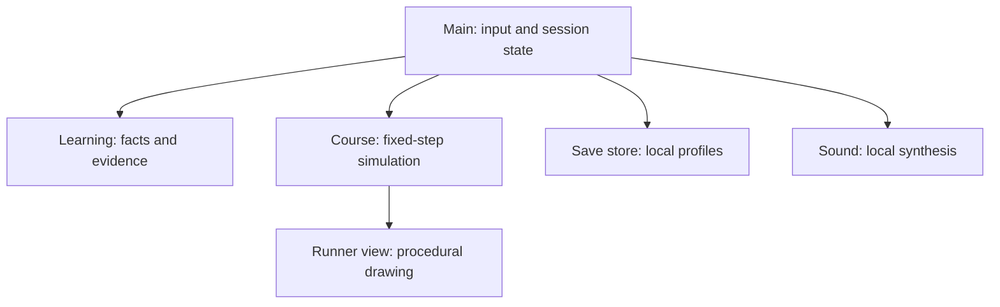

# 03 — Implementation blueprint

## Engine and build boundary

- **Engine:** Godot 4.7.2 stable, standard GDScript build.
- **Renderer:** GL Compatibility for native and web.
- **Simulation:** 60 Hz physics updates.
- **Web:** single-threaded WebAssembly export. Do not introduce shared-memory requirements merely to improve a synthetic benchmark.
- **Dependencies at play time:** the exported local Godot assets only; no model, API key, cloud database or subscription.
- **Autopilot:** vendored at a pinned upstream commit and injected only by the native test bootstrap. The normal game does not start a remote-control listener.

Godot 4.7.2 is selected because the official release is available and the audited Autopilot addon explicitly targets the 4.7 API family. A successful editor import, native test and web export are separate gates. Browser execution is a further gate; do not substitute export success for a playable build.

## Project map and ownership

| Location | Responsibility |
| --- | --- |
| `project.godot` | Engine settings, main scene, renderer and tick rate |
| `scenes/main.tscn` | Root `Main` Control; entry point for the normal game |
| `scripts/main.gd` | Session state machine, responsive controls, input routing, active-time ownership and orchestration |
| `scripts/course.gd` | `DashCourse`, fixed-step runner state, obstacles, jump buffer, collisions and seeded route generation |
| `scripts/runner_view.gd` | `DashRunnerView`, procedural drawing derived from course state; no learning or collision mutations |
| `scripts/learning.gd` | `DashLearning`, arithmetic pools, scheduler, per-occurrence ledger and evidence projection |
| `scripts/save_store.gd` | `DashSaveStore`, versioned device-local profiles, checkpoint persistence, validation and idempotent results |
| `scripts/sound.gd` | Synthesized local audio and mute/volume behavior |
| `assets/` | Local original artwork/font resources with attribution where needed |
| `addons/autopilot/` | Actual upstream addon, license and provenance manifest |
| `tools/autopilot_bootstrap.gd` | Test-only scene bootstrap that adds the upstream runtime bridge |
| `tools/autopilot_local.py` | Deterministic loopback driver using the upstream protocol |
| `tests/` | Native behavior tests, learning fixtures and browser journeys |
| `tests/test_game.gd` | Native course fairness, determinism, jump, collision, waiting and stability tests |
| `tests/browser.mjs` | Browser input journeys and rendered export checks |
| `tools/export_web.sh` | Reproducible release export using the pinned engine/templates |
| `tools/serve.py` | Local HTTP serving for the exported game |
| `tools/run_checks.sh` | Local quality gate orchestration |
| `evidence/screenshots/` | Selected original/remake visual evidence |
| `evidence/runs/` | Generated raw run logs and reports, excluded from normal source tracking |
| `evidence/verification.json` | Selected final verification evidence |
| `docs/` | Design, parity decisions, tests, comparison, QA and licensing context |

The code implements concrete responsibilities rather than a generic engine abstraction. The stable root node name `Main` is part of the instrumentation contract. Controls used by automation need meaningful stable names, even when their layout changes responsively.

The drawing and sound layers consume state or explicit outcome events. They do not decide whether an answer is correct, advance a question, add a first-attempt opportunity or change collision coordinates.

## Scene and UI construction

`Main` fills the viewport and builds the current screen from Godot Controls. The runner view is a noninteractive Control, so it cannot intercept keypad or menu input. Menus and gameplay controls belong under the root's UI hierarchy. Layout is recomputed from the actual visible viewport; a fixed illustration coordinate system is projected into its allotted rectangle.

The initial logical view is 1280 × 800, with a 320-pixel minimum width. Those are layout inputs, not permission to scale every control below a usable touch size. On short or narrow windows, reduce decoration and use a vertical/scrollable layout before hiding required actions.

Buttons are the single source of UI actions. Keyboard shortcuts call the same intent handlers as clicks/taps. Tests should use those buttons and real key events, then inspect state, rather than call private answer methods to manufacture a pass.

## Session state machine

| State | Accepted actions | Clock behavior | Exit conditions |
| --- | --- | --- | --- |
| Menu / setup | Select local profile, mode, arithmetic, pace, target and settings; start | No active session time | Valid start or explicit resume |
| Running | Digits, correction, submit, hint, jump, pause, finish | Active session/question clocks advance | Solved target, pause, early finish or timed expiration |
| Gate recovery / waiting | Retry and applicable controls | Defined per question; no repeated timeout | Correct resolution or explicit finish |
| Paused | Resume, finish, mute or save/return home | Active clocks stop; simulation stops | Explicit resume, finish or home |
| Results | Replay, change setup, title | No evidence mutation from viewing | Explicit next journey |
| Resume choice | Resume or discard saved checkpoint | Time away excluded | Explicit selection |

Some of these states may be implemented as a screen string plus flags rather than an enum. The invariant is the same: no ambiguous state may both accept a gameplay answer and activate a menu control for the same event.

### Transition invariants

1. Starting twice cannot create two session IDs or two running clocks.
2. A resolved gate cannot resolve again because Enter was repeated.
3. Pausing flushes or rebases the timing stamp so the next frame cannot catch up paused time.
4. A hidden browser page suspends active play, and returning requires the appropriate visible state.
5. Finish builds one immutable result under one session ID.
6. Replay creates a new session; merely revisiting results does not.
7. Changing the learner slot never mutates the former learner's active state into the new learner's store.
8. A failed save reports failure and preserves playable in-memory state where possible.

## Three different clocks

### Active thinking time

Use a monotonic clock for measured response age and elapsed active session time. Maintain a last-active stamp or explicit active accumulator. Exclude pause, hidden-page suspension and time away after a reload. Persist ages/elapsed durations, never a process-local monotonic timestamp that will be meaningless in another process.

Submitted-response latency and timeout age are different fields. The latter is an observed deadline event without a submitted answer. It must not be represented as a fast or slow correct response. For retries, record the documented interval since the preceding attempt or assistance boundary; do not silently change from first-display latency to per-retry latency.

### Fixed simulation time

`DashCourse.step(dt, duration, practice, auto_jump)` advances logical movement from the physics loop. Physics does not derive from how quickly drawing finishes. The course can slow visually in Practice while the learner's active thinking time keeps advancing. A frame stall must not create a large unbounded catch-up that teleports the player through hazards.

### Presentation time

Trails, palette accents, particles, sound envelopes and background motion can use animation time. Reduced motion changes that time's effects without changing arithmetic or the collision outcome. Cadence beat phase derives from the session/gate clock; the audio device cannot become the authoritative timer.

## Course simulation interface

`DashCourse` extends `RefCounted`; it has no dependency on a Control, audio player or browser. Its public methods are `reset(seed)`, `new_gate()`, `jump()`, `clear_gate(auto_jump)`, `step(...)`, `snapshot()` and `restore(...)`.

Logical player X is fixed on the track while obstacles and scenery scroll. Gravity, jump speed and the 120 ms input buffer are named constants. The course keeps gate position, obstacle position/kind/active state, jump velocity, recovery, jump count and collision count. Seeded RNG state is checkpointed as a string so JSON numeric conversion cannot corrupt a wide integer.

Correct arithmetic dissolves the current gate's hazard and permits passage. The assist option can launch a jump for visual satisfaction and obstacle handling. Manual input remains available. Motor collisions only affect course recovery and motor counters.

Any automatic jump threshold should depend on the predicted contact time at the selected pace, not a fixed pixel distance that becomes too early when the route slows. Test the whole pace range against the flight time. Do not add ledge-specific coyote time until the course actually contains ledges.

## Learning interface and parity

`DashLearning` extends `RefCounted` and owns its own scheduler and occurrence state. Main supplies measured active durations. Its principal methods are:

| Method | Contract |
| --- | --- |
| `configure(op, limit, seed, evidence, options)` | Build a valid eligible pool and initialize an isolated session |
| `build_fact_pool(op, limit, options)` | Pure pool construction; optional mixed operation subset and answer bounds |
| `next_question()` | Select a fact and create its occurrence without inventing a response |
| `submit(answer, latency_seconds, assisted)` | Validate and record one actual response if the occurrence accepts it |
| `timeout(latency_seconds)` | Record one deadline event, retain the occurrence for assisted retry, and reject repeated timeout events |
| `use_hint()` | Return help and mark assistance without inventing an answer |
| `summary()` | Read-only aggregate of the occurrence ledger |
| `stats()` | Direct/inferred/untested and current practice-tier projection |
| `export_evidence()` | Persistent learner evidence without sharing live mutable state |
| `export_state()` / `restore_state()` | Versioned checkpoint of fact selection, occurrence and scheduler state |

The timeout's nonresponse age is stored in `timeout_latencies`; actual submissions use `latencies`. `attempts` preserves submissions plus timeout events, while `submitted_answers` exposes actual submissions. `mean_response_seconds` uses only occurrences with a submitted response, and `response_samples` names the denominator. Exact parity decisions are described in [LEARNING-PARITY.md](LEARNING-PARITY.md). Boundary values include a pool with zero, integer division, duplicate submission, multiple wrong attempts, hint before first input, timeout after an error, and ending an unobserved question.

Original-source fixtures are generated with `tools/generate_learning_fixtures.mjs` and stored under `tests/fixtures/`. They must come from the actual pinned original code, not a second handwritten model of the new implementation. Arithmetic pool parity and deterministic selection parity should be assessed separately: a correct pool does not establish an identical scheduler.

An intentional improvement resets the independent streak when an assisted success occurs, preventing old unassisted streaks from surviving an intervening helped answer. Any such divergence is named in the parity document and covered by a focused regression.

## Persistence and recovery

`DashSaveStore` uses a versioned root `{version, profiles}`. Native builds store `user://diagnostic_dash.json`. The web adapter uses the synchronous browser `localStorage` key `ddgodot:v1:user://diagnostic_dash.json`, plus `.bak` and `.corrupt` siblings. An actual immediate-reload test exposed that Godot's virtual filesystem accepted writes before IndexedDB synchronization completed. The web adapter therefore validates, atomically sets, and reads back the browser record before reporting success. Quota and access exceptions return a visible failure; no arbitrary sleep is used as evidence of durability.

Each profile contains evidence, settings, sessions, a checkpoint and completed session IDs. The UI selects one of three local slots. These IDs represent local separation only; they are not credentials or access controls.

Native writes use a temporary file and validate serialized data before replacement. Both adapters retain a previous valid backup and propagate errors. Corrupt or unsupported data is not overwritten implicitly. Explicit backup restoration preserves the corrupt primary for inspection; a destructive reset requires a deliberate UI action. One active tab per player is the supported concurrency model; independent browser tabs do not share a transactional writer.

`complete_session(profile_id, result)` validates counter consistency and, when present, the fact ledger. The stable session ID maps to a canonical payload fingerprint. Repeating the same payload is idempotent; a different payload with that ID is refused. Stored session display history may be bounded, but dropping old display rows must not permit duplicate IDs to be counted again.

A checkpoint stores session ID, profile, setup, learning snapshot, course snapshot, typed answer, active ages and progress. Save after input/state transactions and at least once per second while running. A resume flow validates the entire shape before applying it. Do not restore a typed answer by automatically submitting it.

## Web shell and export

The web shell provides a visible loading state, failure message if WebGL/WASM cannot start, a focusable game surface and browser-friendly sizing. It must load all game assets from the same deployable output folder. The export contains `.html`, `.js`, `.wasm`, `.pck` and any engine-generated support files required by the selected preset.

Godot's physical WebGL backing buffer may be multiplied by device pixel ratio. The scene sets `Window.CONTENT_SCALE_MODE_CANVAS_ITEMS` with a content scale size taken from CSS `innerWidth`/`innerHeight`, so a 390-pixel phone uses the phone layout at different pixel densities. A retained JavaScript resize callback updates the logical size after live browser resizes; a Control resize signal alone cannot detect a changed backing canvas when the old logical viewport is fixed. Browser tests measure target sizes in CSS pixels, verify initial DPR 2 phone sizing and check live-resize reflow. Responsive controls live in a vertically scrollable Godot container for short windows.

Serve it with HTTP rather than opening `file://`. Use the repository export script/preset from README. The release preset should exclude tests, fixtures, development reports, source documentation and the Autopilot addon. The export does not need shared-memory headers when using the single-threaded preset; deployers should still send correct MIME types for `.wasm` and avoid stale mixed-version cache files.

Native and browser paths share gameplay GDScript. A browser bridge may expose a read-only snapshot only in an explicit QA launch such as `?qa=1`. Browser automation should supply real keyboard, pointer or touch input. Do not expose a production endpoint that accepts arbitrary scene calls.

## Autopilot and local automation

Read [AUTOPILOT-AUDIT.md](AUTOPILOT-AUDIT.md) before changing the addon. The normal upstream Aura/Jev inference path has service requirements. This project uses the upstream Godot instrumentation with a separate deterministic driver, which is the explicit free fallback allowed by the brief.

`tools/autopilot_bootstrap.gd` loads `addons/autopilot/playtest.gd` and the normal main scene in a test process. `tools/autopilot_local.py` binds a loopback-only WebSocket server on an ephemeral port, verifies the protocol-1 handshake, disables sharing, and controls the game using upstream `ui_act` and key operations. Read-only snapshots are fetched through the upstream reflection operation.

Each run writes a structured report, protocol trace and Godot log. The report must distinguish bridge verification from completed gameplay goals. Headless capture refusal is a valid limitation, not a screenshot. Rendered browser tests supply visual evidence.

## Optional React/TanStack host integration

The standalone build deliberately does not move identity, authoritative learner history or server validation into GDScript. A future host wrapper can embed the export and use a narrowly defined message protocol, but must validate:

- Expected frame source and explicit origin.
- Protocol version and bounded payload shape.
- Authenticated learner on the server, rather than trusting a client-supplied profile.
- Stable run ID and immutable completion payload.
- Durable outbox acknowledgement separately from final server acknowledgement.

The game's local slots must not be silently equated with existing production learners. Host integration requires its own regression fixtures and migration plan, particularly for old sessions without an exact first-attempt denominator. No automatic upload of local records is included by this blueprint.

## Verification gates

Read [05-TEST-PLAN.md](05-TEST-PLAN.md) for the final executable suite. Native course tests run with `godot --headless --path . --script tests/test_game.gd`; the separate learning suite runs `tests/test_learning.gd`. The minimum sequence is import → native learning/course tests → real Autopilot bridge and goals → export → real-browser journeys → screenshot review → repair → repeat the complete unchanged release suite twice. Archive observed results; do not convert unavailable browsers into passes.

Targets are smooth 60 FPS desktop play and usable constrained-device play. Record startup and frame distributions under the test conditions, including headless/software-rendering limitations. Those measurements are not a claim about a physical low-powered tablet until such a device is tested.
