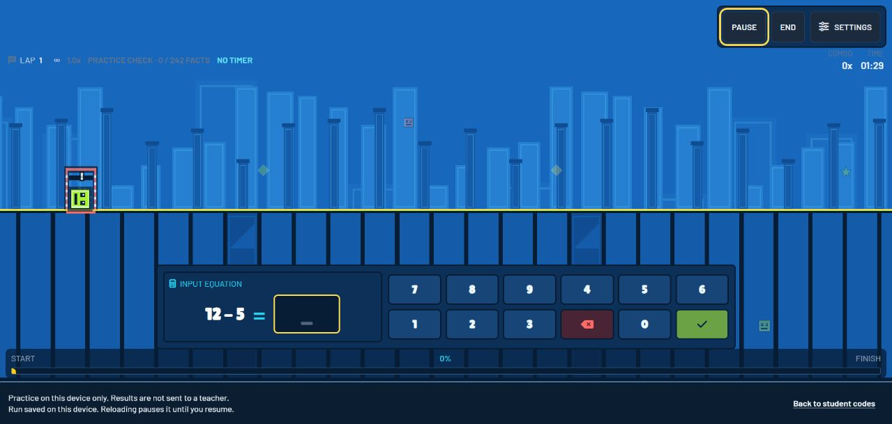
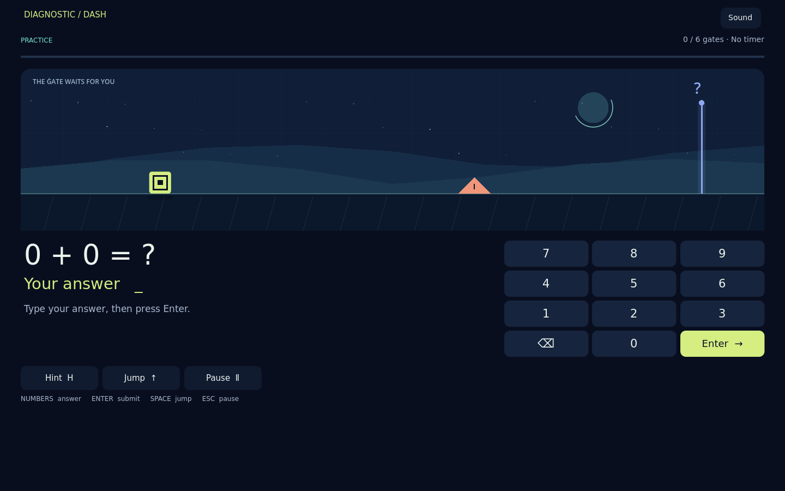

# 06 — Original versus Godot remake

## Assessment and evidence boundary

The Godot edition preserves the distinctive loop: arithmetic opens a route for a geometric runner. It delivers an independent, editable game with finite sessions, deliberate answer entry, local recovery, and reproducible verification. It is a substantial reinterpretation of the game, not a complete replacement for the original school application. Several usability choices are promising design changes; automated completion does not establish that learners prefer them or learn more from them.

The source baseline is [geometrymash at `f43bf817e8dc20c554615a9fd39cb79585fab8c2`](https://github.com/H-H-E/geometrymash/tree/f43bf817e8dc20c554615a9fd39cb79585fab8c2). The deployed [original](https://dd.vlc.tools/) was inspected through its guest Practice journey. Correct automatic submission and wrong-answer recovery were observed, and the session was ended. Original timed modes, authenticated staff workflows, and cross-device records were not exercised. A live deployment may differ from the pinned source. [Game DNA](01-GAME-DNA.md) identifies the inspected implementation files and separates source findings from live observations.

Release evidence belongs to the [QA report](07-QA-REPORT.md), [browser pass 1](../evidence/verification/browser-release-1.json), and [browser pass 2](../evidence/verification/browser-release-2.json). Those records establish exactly which exported-game journeys ran, their source/build identities, and their results. The [test plan](05-TEST-PLAN.md) defines the boundaries of each test layer.

## Recognizable identity, simpler choices

| Area | Original baseline | Godot edition | Assessment |
| --- | --- | --- | --- |
| Core action | Correct arithmetic clears a gate and triggers movement/jumping | Correct arithmetic clears its gate and visibly advances the runner | Essential causal relationship preserved |
| Session choices | Practice, Speed Racer and Blitz; separate Classic/Cadence course style | Practice, Classic and Cadence presets | Fewer independent choices; original combinations are not all retained |
| Practice endpoint | Untimed, learner-ended loop | Untimed questions with 6, 12 or 24 solved-gate targets; early finish available | Predictable stopping point added; indefinite single-run Practice removed |
| Answer entry | Live guest Practice automatically submits a correct answer | Digits followed by explicit Enter or a large submit button | Reduces answer-prefix ambiguity; requires one extra action |
| Motor control | Answer-driven automatic jumping is central | Default assistance plus optional manual jump and a short input buffer | Adds motor agency while keeping arithmetic independently accessible |
| Failure | Wrong answers and timed pressure affect gate recovery | Readable retries; one timeout changes the gate into supported practice | Recovery remains possible without inventing independent success |
| Progress | Lap, score, combo and source learning views | Solved target, first-try ratio, support counts and fact ledger | Evidence is prominent; original scoring and presentation breadth are reduced |

The mode names require particular care. Classic and Cadence were course styles in the source. Here they are timed session presets, with three explicit gate durations. Cadence uses locally synthesized rhythm and restrained pulses; it is not a port of the original phrase-derived composition system. This is a named product simplification, not evidence of feature parity. The complete decisions are in the [design document](02-GAME-DESIGN-DOCUMENT.md).

## Learning integrity: preservation and deliberate corrections

The strongest measurable continuity is in arithmetic and adaptive selection. The GDScript learning component is checked against 600 executed steps from the pinned original JavaScript scheduler. The fixture covers all five operation selections and compares questions, changing fact records, response tiers and retry queues. This is specific regression evidence, not a proof that every original interface state was ported. [Learning parity](LEARNING-PARITY.md) documents the fixture provenance and exact limits.

The original pool meanings remain intact: addition includes zero; subtraction constructs a nonnegative difference; multiplication tables stop at 12; division has nonzero divisors and integer quotients. A selected family does not impose the same maximum on every displayed number. Mixed mode combines the same underlying pools. The unrestricted keypad avoids changing an operation simply to fit a restricted answer widget.

The remake also preserves the original distinction between first-attempt opportunity and eventual success. A wrong response followed by retries and a timeout remains one observed question occurrence. Ending with an unanswered question creates no observation. A hinted or recovered solution may advance the game but cannot become independent first-try evidence. These are valuable original contracts, not inventions of the remake.

Two intentional corrections are narrower than a general claim of educational superiority. Timeout duration is retained as nonresponse timing rather than inserted into measured answer latency. Assisted success resets the independent-success streak and promotion counter, so help cannot bridge separate independent streaks. Imported aggregate averages cannot fabricate recent fast responses. These policies are conservative accounting decisions with dedicated tests; no study here establishes improved attainment or diagnostic validity.

Adaptation is applied consistently across the three new presets. It retains missed-fact requeues, spacing, anti-repeat behavior and the distinction between measured and inferred related facts. The original scheduler primarily served Practice. The new implementation therefore broadens where that mechanism operates, while the selected mode changes pressure rather than the meaning of evidence.

## Interaction and visual changes

The original guest screenshot shows a blue geometric runner with many visible status and control elements. The remake uses a quieter dark background, a lime player/action accent and clearly separated equation, input and keypad regions. Desktop places input beside the arithmetic; a narrow phone stacks them. These are observable layout differences in [original Practice](../evidence/screenshots/original-practice.png), [remake desktop play](../evidence/screenshots/remake-playing-desktop.png), and [phone play](../evidence/screenshots/remake-phone-dpr2.png). They support an interpretation of clearer hierarchy, but no controlled task-time or error-rate comparison was conducted.

| Original guest Practice | Godot Practice |
| --- | --- |
|  |  |

These captures document the actual interfaces at different viewport sizes, rather than a controlled readability experiment. The equation, route and answer controls remain recognizable while their hierarchy and spacing change.

The exported game supports keyboard navigation, touch answer entry, visible focus, sound controls, reduced motion and default jumping assistance. Practice permits unlimited thinking time. A readable result distinguishes first-try success from supported completion and exposes the underlying facts. These options address concrete access needs; they do not establish WCAG conformance. Canvas semantics, screen-reader operation and the original DOM experience need a separate accessibility comparison.

Phone verification caught actual remake defects: the canvas initially used backing pixels as layout pixels at device scale 2, and a results label could extend beyond the right edge. Those were development failures in this remake, not defects attributed to the original. Correcting CSS-based logical sizing and label layout made the captured phone state usable. Touch-only completion and screenshot review are evidence of that repair. They are not substitutes for testing physical-device ergonomics, arbitrary text scaling or native browser-UI 200% zoom.

The seeded course and separated collision simulation improve inspectability. Testing identified a slow-pace obstacle whose collision span exceeded the available jump clearance; the collision core and assistance timing were repaired and checked across seeds, paces and simulation steps. This establishes that the tested crossings are achievable. Whether jumping feels satisfying remains a human playtest question.

## Reliability and local operation

| Capability | Shipped behavior | Practical limit |
| --- | --- | --- |
| Interrupted run | Explicit Resume or Discard; validated question, input, clocks, scheduler and course checkpoint | Local browser/device only |
| Completed result | Stable session identity and conflicting-duplicate rejection | Client records are not authoritative school assessment data |
| Player separation | Three distinct local slots with separate settings, history and pending run | Slots are not authenticated identities |
| Storage failure | Visible failure, preserved damaged data and result export | Browser eviction, manual clearing and simultaneous same-player tabs remain limitations |
| Offline play | Production assets cached after a successful initial load | Cache availability depends on the browser and origin |
| Reproducibility | Pinned engine, seeded fixtures, native suites and real-browser reports | Does not reproduce another device's GPU or audio behavior |

An actual immediate-reload test found that acknowledging Godot's in-memory filesystem write could precede browser persistence. The browser adapter now validates and reads back a synchronous local-storage record before acknowledging success; native saves retain verified temporary-file replacement. This is a demonstrated repair within the remake. It does not imply the original application's remote persistence was unreliable. [Web compatibility](WEB-COMPATIBILITY.md) explains the save adapter and the separately verified runtime presentation adjustment without disguising browser-specific workarounds as gameplay improvements.

The production game has no hosted model, account service or runtime asset dependency. Actual upstream Autopilot instrumentation is included for development and excluded from the export. A deterministic free local driver exercises that instrumentation with real inputs. This was not an Aura/Jev autonomous-model session; the [audit](AUTOPILOT-AUDIT.md) records that distinction and the upstream service dependencies.

## What is smaller, omitted or still unproven

The remake does not implement the original authenticated learner host, teacher roster, assignment links, server validation or cross-device synchronization. JSON export is available, but it is not the original reporting and administration suite. The original slider/input variants, full pattern-scaffolding interface, broader visual themes, simulated rivals and full Cadence composition are not reproduced. Cosmetic choice is intentionally modest. These are material scope differences for a school deployment.

There is no measured original startup, memory or frame-time baseline under matching conditions. Consequently no speedup, lower memory use or overall performance advantage is claimed. The target of smooth 60 FPS is a design goal, not a certified result across hardware. Cloud software-rendered browser metrics in the QA report identify their environment and must not be presented as physical-phone measurements.

Linux browser-engine passes do not establish Safari on an iPhone. Physical mobile performance, audible sound quality, true browser-UI 200% zoom, screen-reader workflows and learner preference remain unverified. A long deterministic simulation checks state stability; it does not replace a prolonged rendered session on a low-powered device.

The evidence supports a specific conclusion: this repository provides a complete independent arithmetic-runner loop, preserves important source learning contracts, names its deliberate changes, and subjects the actual export to reproducible checks. Enjoyment, learning benefit and replacement of the original school's complete workflow require further evidence and integration.
